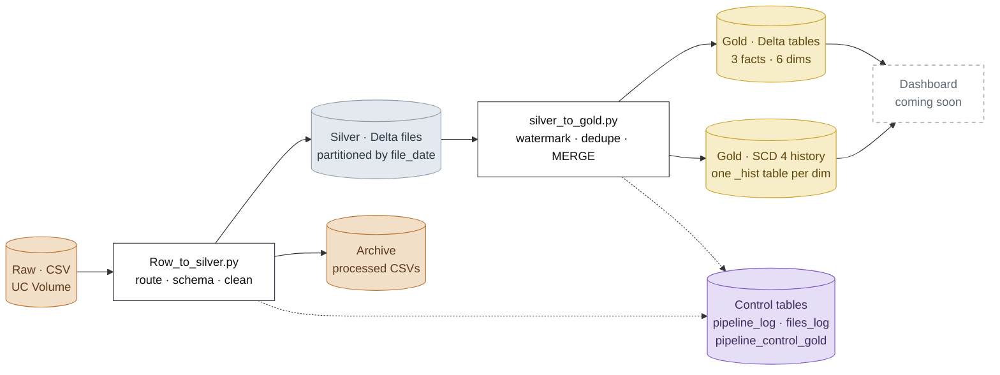
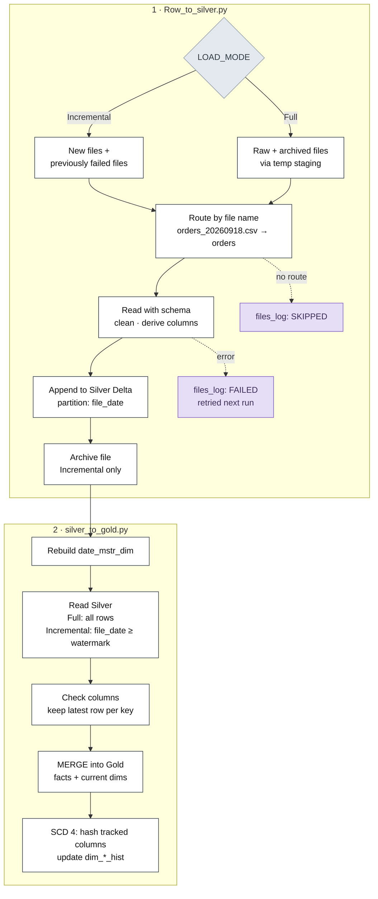
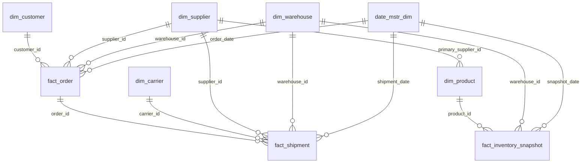
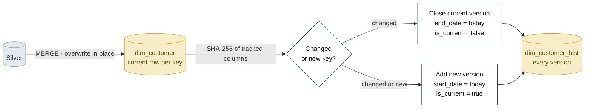

<div align="center">

# Supply Chain Data Pipeline

**Databricks medallion pipeline: daily supply chain CSVs → Silver Delta → Gold star schema with SCD Type 4 history.**

[](#architecture)
[](#pipeline)
[](#architecture)
[](#gold-data-model)
[](#project-structure)
[](#roadmap)

[Architecture](#architecture) · [Pipeline](#pipeline) · [Gold model](#gold-data-model) · [SCD Type 4](#scd-type-4-history) · [Logging](#logging-and-control) · [Dashboard](#dashboard) · [Run](#how-to-run)

</div>

---

## Architecture



| Layer | Format | Location |
|---|---|---|
| Raw | CSV, named `<entity>_YYYYMMDD.csv` | `/Volumes/workspace/default/supplychain/Raw_data/` |
| Archive | CSV, moved after a successful incremental load | `/Volumes/workspace/default/supplychain/processed_raw_files/` |
| Silver | Delta (Parquet + transaction log), partitioned by `file_date` | `/Volumes/workspace/default/supplychain/silver_data/<entity>/` |
| Gold | Delta tables | `supply_chain.gold` |
| Control | Delta tables | `supply_chain.control` |

## Pipeline



| Setting | File | Values | Effect |
|---|---|---|---|
| `LOAD_MODE` | `config/config.py` | `Incremental` · `Full` | Raw → Silver: new and previously failed files only, or every raw and archived file through a temporary staging folder |
| `load_type` (per table) | `config/config_gold.py` | `INCREMENTAL` · `FULL` | Silver → Gold: rows with `file_date` on or after the table's watermark, or all Silver rows. The first run is always full. |

## Gold data model



| Table | Type | Key | Silver read |
|---|---|---|---|
| `fact_order` | Fact | `order_id` | Incremental |
| `fact_shipment` | Fact | `shipment_id` | Incremental |
| `fact_inventory_snapshot` | Fact | `product_id`, `warehouse_id`, `snapshot_date` | Incremental |
| `dim_customer` | Dimension · SCD 4 | `customer_id` | Incremental |
| `dim_product` | Dimension · SCD 4 | `product_id` | Full |
| `dim_supplier` | Dimension · SCD 4 | `supplier_id` | Full |
| `dim_warehouse` | Dimension · SCD 4 | `warehouse_id` | Full |
| `dim_carrier` | Dimension · SCD 4 | `carrier_id` | Full |
| `date_mstr_dim` | Dimension | `date_key` | Generated |

Facts and dimensions are upserted with `MERGE` on the key. Every table except `date_mstr_dim` carries `Insert_dt` and `Update_dt`.

**`date_mstr_dim`**
- Generated for 2026-01-01 to 2029-12-31 and rebuilt on every Silver → Gold run. `date_key` is `yyyyMMdd`.
- The fiscal year starts in June: `fiscal_month` 1 = June, and labels look like `FY2026-2027`.
- `qtr_offset` and `fiscal_qtr_offset` count quarters from today: `0` is the current quarter, `-1` the previous one.

## SCD Type 4 history

Current values are in `dim_*`; every version is in `dim_*_hist`.



| History table | Tracked columns |
|---|---|
| `dim_customer_hist` | `customer_segment`, `customer_tier`, `credit_term`, `credit_limit` |
| `dim_product_hist` | `primary_supplier_id`, `unit_cost`, `unit_price`, `margin_pct`, `weight_kg`, `is_fragile`, `is_temperature_controlled`, `shelf_life_days` |
| `dim_supplier_hist` | `lead_time_days`, `rating`, `payment_due` |
| `dim_warehouse_hist` | `capacity_sqft`, `manager_name`, `current_utilization_pct` |
| `dim_carrier_hist` | `carrier_type`, `vehicle_type`, `max_weight_kg`, `on_time_rate_pct`, `damage_rate_pct`, `cost_per_km` |

History columns: `start_date`, `end_date` (NULL while current), `is_current`.

<details>
<summary><b>Example queries</b></summary>

```sql
-- Order value by fiscal quarter and customer tier
SELECT d.fiscal_year_label,
       d.fiscal_quarter,
       c.customer_tier,
       SUM(o.order_value) AS order_value
FROM   supply_chain.gold.fact_order    o
JOIN   supply_chain.gold.date_mstr_dim d ON d.date = to_date(o.order_date)
JOIN   supply_chain.gold.dim_customer  c ON c.customer_id = o.customer_id
GROUP  BY d.fiscal_year_label, d.fiscal_quarter, c.customer_tier
ORDER  BY d.fiscal_year_label, d.fiscal_quarter;

-- Customer tier at the time of each order (history starts at the first pipeline run)
SELECT o.order_id,
       o.order_date,
       h.customer_tier
FROM   supply_chain.gold.fact_order o
LEFT JOIN supply_chain.gold.dim_customer_hist h
       ON  h.customer_id = o.customer_id
       AND to_date(o.order_date) >= h.start_date
       AND (h.end_date IS NULL OR to_date(o.order_date) < h.end_date);
```

</details>

## Logging and control

All in `supply_chain.control`:

| Table | One row per | Written by | Holds |
|---|---|---|---|
| `pipeline_log` | Run (`session_id`) | Raw → Silver | Status, start and end time, duration, file counts, total records, error |
| `files_log` | File and layer | Raw → Silver | `SUCCESS` · `FAILED` · `SKIPPED`, row count, notes, `session_id` |
| `pipeline_control_gold` | Gold table and run | Silver → Gold | Watermark (`last_file_date`), rows processed, status, error |

## Dashboard

> [!NOTE]
> In progress. Screenshots will be added here.

<!-- <p align="center"></p> -->

## Project structure

```text
Supply_chain/
├── config/
│   ├── config.py                  # Raw → Silver: paths, LOAD_MODE, file routing
│   ├── config_gold.py             # Gold tables, keys, load types, SCD 4 tracked columns
│   └── pipeline_logger.py         # pipeline_log and files_log writers
└── Ingestion/
    ├── Raw_to_silver/
    │   └── Row_to_silver.py       # Raw → Silver
    ├── Silver_to_gold/
    │   └── silver_to_gold.py      # Silver → Gold, date dimension, SCD 4 history
    └── transformations/
        ├── cleaning_raw_silver.py   # per-entity cleaning and derived columns
        ├── cleaning_silver_gold.py  # column checks, audit columns, date dimension
        ├── schema_raw_silver.py     # CSV read schemas
        └── schema_silver_gold.py    # Gold schemas
```

## How to run

1. Create the Unity Catalog objects:

   ```sql
   CREATE CATALOG IF NOT EXISTS supply_chain;
   CREATE SCHEMA  IF NOT EXISTS supply_chain.control;
   CREATE SCHEMA  IF NOT EXISTS supply_chain.gold;
   CREATE VOLUME  IF NOT EXISTS workspace.default.supplychain;
   ```

2. Clone the repo into a Databricks Git folder. Update the `sys.path.append(...)` workspace paths in the scripts and the volume paths in `config/`.
3. Upload CSVs named `<entity>_YYYYMMDD.csv` to `Raw_data/`. Entities: `customers`, `products`, `suppliers`, `warehouses`, `carriers`, `orders`, `shipments`, `inventory_snapshot`.
4. Run `Row_to_silver.py`, then `silver_to_gold.py`, or schedule them as two dependent tasks in a Databricks Job.

## Roadmap

- [x] Raw → Silver with schemas, cleaning and file-level logging
- [x] Silver → Gold `MERGE` with per-table watermarks
- [x] SCD Type 4 history for all five dimensions
- [x] `date_mstr_dim` with a June fiscal calendar
- [ ] Dashboard
- [ ] Sources beyond CSV files

## Author

**Ghanshyam Hadiya**<br/>
B.E. Information Technology, Ahmedabad Institute of Technology (May 2026)

[](https://www.linkedin.com/in/ghanshyam-hadiya-13971b2bb/)
[](https://github.com/ghanshyamhadiya)
[](https://ghanshyam-hadiya0.vercel.app/)

<p align="right"><a href="#supply-chain-data-pipeline">Back to top</a></p>
